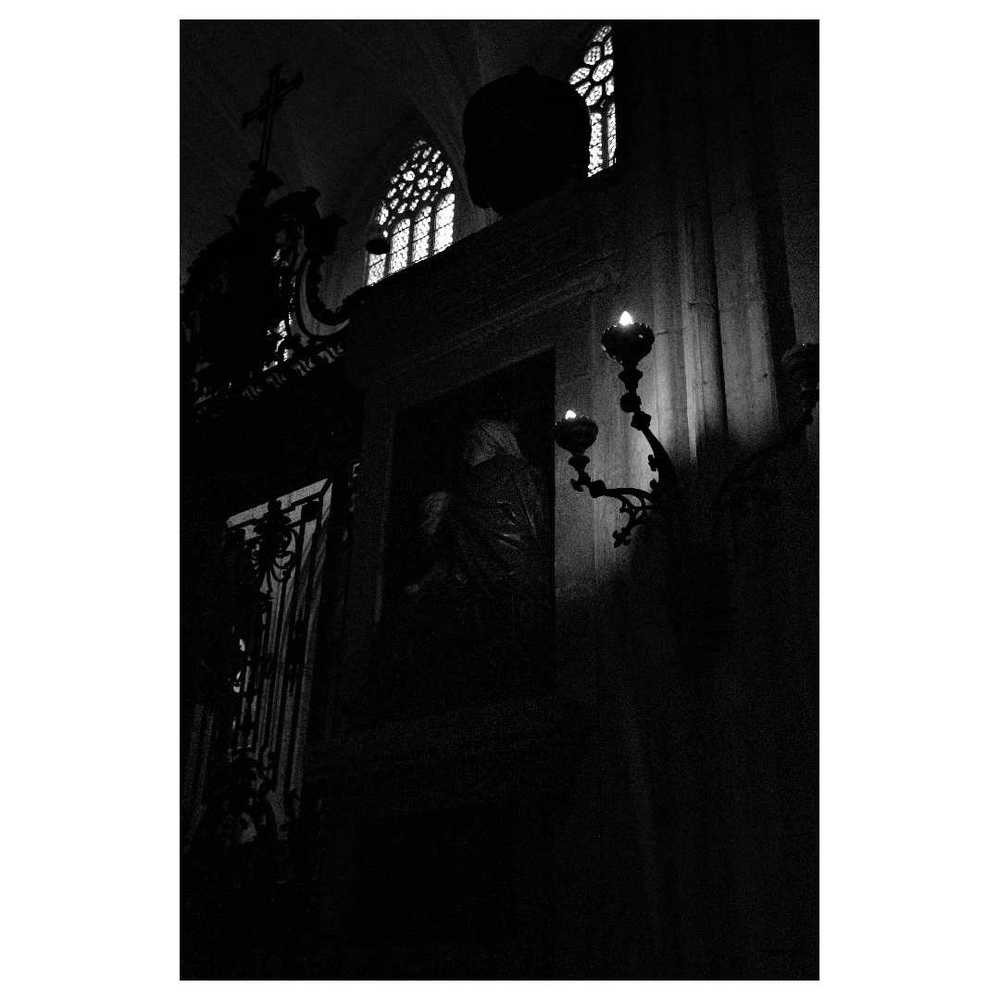

# wba

`wba` adds white borders to photos so they fit Instagram, shrinks them for
sharing, and deletes the Panasonic raws that RawTherapee never developed.

```
wba border <dir>            # write <dir>/bordered/bordered_<name>.jpg for every JPEG and PNG
wba compress <dir>          # write <dir>/compressed/compressed_<name>.jpg, smaller
wba clean <dir>             # delete raws without a developed copy in <dir>/converted/
wba <verb> <dir> --apply    # verbs only print what they would do until you add --apply
```

|              Original               |                 With borders                 |
| :---------------------------------: | :------------------------------------------: |
|  |  |

## Vocabulary

| Term | Meaning |
|---|---|
| **Photo directory** | A directory that contains a `converted/` subdirectory, which is where RawTherapee writes developed photos. `clean` never touches a directory without one: no `converted/` means no sorting happened there, so nothing is a candidate. |
| **Raw** | A file at the root of a photo directory matching `--pattern` (default `*.rw2`, case-insensitive). |
| **Stem** | The raw file name without its extension: `IMG_1264`. |
| **Developed** | A raw is developed when any file in `converted/` has a name that starts with its stem, case-insensitively. `IMG_1264.jpg`, `IMG_1264_converted.jpg` and `IMG_1264-bw.tif` all develop `IMG_1264.RW2`. The extension does not matter. |
| **Candidate** | A raw that is not developed and whose stem matches no `--exclude` glob. |
| **Sidecar** | The `<raw name>.pp3` file RawTherapee leaves next to the raw. A candidate's sidecar is deleted with it; the sidecar of a raw that is kept is kept. |

## How a verb runs

Every verb plans first and prints the plan, one `would ...` line per file,
then the total. With `--recursive` each directory opens with a
`####### <dir>: <count>, <size>` banner. Nothing is written or deleted
until you add `--apply`, which does the whole plan and prints the same
lines in the past tense. Errors are printed with the same `#######`
banner on stderr.

`clean` marks a raw that has a `.pp3` sidecar but nothing in `converted/`
with `####### has a .pp3 but nothing in converted/`: you edited it in
RawTherapee and never exported it. Look before you `--apply`, or keep it
with `--exclude <stem>`.

| Flag | Default | Meaning |
|---|---|---|
| `--apply` | false | Do it. Without this flag a verb only prints what it would do. |
| `--recursive` | false | Walk the tree below `<dir>`, skipping dot-directories. `clean` also skips `converted/`, which holds no raws; `border` and `compress` enter it, since that is where the exports are, and skip only their own `bordered/` and `compressed/`. |
| `--verbose` | false | Also print skipped items and why. |

A file that fails is printed on stderr with its error, the verb goes on, and
the exit code is 1 at the end. A verb with nothing to do prints `nothing to
do` and exits 0.

## wba border <dir>

Writes a copy of every `.jpg`, `.jpeg` and `.png` at the root of `<dir>` on
a white canvas, centred, scaled to leave the border ratios below.

| Flag | Default | Meaning |
|---|---|---|
| `--width`, `--height` | 1080 | Canvas size in pixels. |
| `--landscape-vert`, `--landscape-horiz` | 0.05, 0.03 | Border ratios for landscape photos, as a fraction of the canvas. |
| `--portrait-vert`, `--portrait-horiz` | 0.005, 0.18 | Border ratios for portrait photos. |
| `--jpeg-quality` | 100 | JPEG output quality. PNG in gives PNG out. |
| `--prefix` | `bordered_` | Prefix of the output file name. |
| `--out` | `<dir>/bordered` | Output directory. Relative to each photo directory with `--recursive`. |
| `--force` | false | Overwrite an output file that already exists; otherwise it is skipped. |
| `--workers` | number of CPUs | Photos processed at once. |

```
$ wba border 2024-10-paris
would write bordered/bordered_IMG_1264.jpg
would write bordered/bordered_IMG_1271.jpg
2 files. Re-run with --apply to write them.
```

## wba compress <dir>

Writes a smaller copy of every `.jpg`, `.jpeg` and `.png` at the root of
`<dir>`: JPEGs re-encoded at `--jpeg-quality`, PNGs at the best
compression level, same pixel size. The only lever is the quality. At 100
a JPEG usually comes out larger than the original, and the total says so;
85 is where the loss stops being visible on a screen.

| Flag | Default | Meaning |
|---|---|---|
| `--jpeg-quality` | 100 | JPEG output quality. |
| `--prefix` | `compressed_` | Prefix of the output file name. |
| `--out` | `<dir>/compressed` | Output directory. Relative to each photo directory with `--recursive`. |
| `--force` | false | Overwrite an output file that already exists; otherwise it is skipped. |
| `--workers` | number of CPUs | Photos processed at once. |

Measured on the sample photo of this repository:

| `--jpeg-quality` | Output | Result |
|---|---|---|
| 100 | 13 MB | 1.1 MB larger |
| 95 | 7.4 MB | 4.2 MB saved |
| 85 | 3.8 MB | 7.7 MB saved |

```
$ wba compress 2024-10-paris --jpeg-quality 85 --apply
wrote compressed/compressed_IMG_1264.jpg, 12 MB -> 3.8 MB
1 file written, 7.7 MB saved.
```

## wba clean <dir>

Deletes the raws of `<dir>` that RawTherapee never developed.

| Flag | Default | Meaning |
|---|---|---|
| `--pattern` | `*.rw2` | Glob on the file name that marks a raw. |
| `--exclude` | none | Glob on the stem to keep. Repeatable: `--exclude 'IMG_12*' --exclude IMG_1300`. |

Taking a photo out of the list is `--exclude <stem>` on the next run. There is
no config file, no prompt and no trash directory: the dry-run default is the
safety net.

### Worked example

Before:

```
2024-10-paris/
├── IMG_1264.RW2
├── IMG_1264.RW2.pp3
├── IMG_1271.RW2
├── IMG_1280.RW2
├── IMG_1280.RW2.pp3
└── converted/
    └── IMG_1280.jpg
```

```
$ wba clean 2024-10-paris
would delete IMG_1264.RW2
would delete IMG_1264.RW2.pp3
would delete IMG_1271.RW2
3 files, 49 MB. Re-run with --apply to delete them.

$ wba clean 2024-10-paris --apply
deleted IMG_1264.RW2
deleted IMG_1264.RW2.pp3
deleted IMG_1271.RW2
3 files deleted, 49 MB freed.
```

After:

```
2024-10-paris/
├── IMG_1280.RW2
├── IMG_1280.RW2.pp3
└── converted/
    └── IMG_1280.jpg
```

`IMG_1280.RW2` stays because `converted/IMG_1280.jpg` starts with its stem,
and its sidecar stays with it.

## Install

With Go installed, on any OS:

```
go install github.com/evaneecloo/white_border_adder/cmd/wba@latest
```

Or take `wba-windows-amd64.exe`, `wba-linux-amd64` or `wba-darwin-arm64`
from the latest GitHub release.

### Windows

1. Download `wba-windows-amd64.exe` from the release page, rename it to
   `wba.exe` and put it in a folder on your `PATH`, for example
   `C:\Users\<you>\bin`. To add that folder to `PATH`, open
   *Edit the system environment variables* and append it to the user `Path`.
2. Open PowerShell or Windows Terminal in the photo directory (Shift +
   right click, *Open PowerShell window here*) and run the verbs on `.`:

```
wba clean .             # read the list, nothing is deleted
wba clean . --apply     # delete it
wba border . --apply
wba compress . --jpeg-quality 85 --apply
```

Paths work with either slash: `wba clean D:\photos\2024-10-paris` and
`wba clean D:/photos/2024-10-paris` are the same.

### From source

```
make build            # ./wba for the current OS
make build-windows    # ./wba.exe, from Linux or macOS
make install          # ~/.local/bin/wba plus zsh and bash completion files
make test
make lint             # needs golangci-lint v2
```

### Shell completion

`wba completion zsh`, `bash`, `fish` or `powershell` prints the script.
`make install` writes the zsh and bash ones next to the binary under
`~/.local/share`; for zsh, `~/.local/share/zsh/site-functions` must be in
`fpath` before `compinit`. Since the binary generates the script, a new
build followed by `make install` is all it takes after a change. For
PowerShell on Windows, add to your `$PROFILE`:

```
wba completion powershell | Out-String | Invoke-Expression
```
